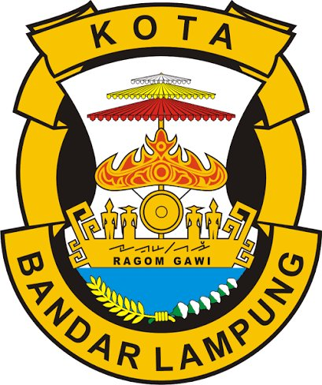

# SIPANDU Smart City: UI Design Skill

Sistem Pengaduan dan Penanganan Infrastruktur Kota Terpadu, Kota Bandar Lampung. Skill ini merangkum desain Google Stitch (4 layar) menjadi aturan yang bisa langsung dipakai saat membangun UI dengan Rust (Axum) + PostgreSQL/PostGIS.

## 1. Urutan prioritas sumber

Jika dua sumber bertentangan, ikuti yang lebih atas:

1. **PRD** (`PRD_SIPANDU_Smart_City.docx`): scope, role, status, data model, requirement.
2. **Skill ini**: token desain, pola komponen, penyelarasan Stitch vs PRD (bagian 8).
3. **HTML Stitch**: referensi visual saja. Jangan salin mentah fitur yang tidak ada di PRD.

## 2. Aturan wajib

1. **Footer di semua halaman** (termasuk login dan registrasi) berisi tiga hal sekaligus: logo Pemda Kota Bandar Lampung, logo Universitas Teknokrat Indonesia, dan teks copyright. Spesifikasi di bagian 3.
2. Teks copyright **persis** (tidak boleh diubah, dipersingkat, atau diganti tahun): `Copyright©2026 by Mutia Afif Ramadhani dan Dr. Erliyan Redy Susanto, M.Kom`
3. Alt text logo persis: `Logo Pemda Kota Bandar Lampung` dan `Logo Universitas Teknokrat Indonesia`.
4. Logo dimuat dari file lokal (`/static/img/logo_pemda.png`, `/static/img/logo_uti.png`). **Jangan hotlink** URL `googleusercontent.com` dari export Stitch karena bisa kedaluwarsa.
5. Bahasa antarmuka: Indonesia.
6. Navigasi **berbasis role**: Warga hanya melihat Portal Warga, Petugas hanya Petugas Lapangan, Admin melihat Command Center dan menu admin. Tab ketiga layar di Stitch hanya untuk demo.
7. **Jangan menampilkan NIK** di UI mana pun (PRD tidak mengumpulkan NIK).
8. Jangan menampilkan klaim fitur yang tidak dibangun (AI, CCTV, enkripsi SHA-256, badge "Live" bila tidak ada data langsung). Lihat bagian 8.
9. Responsif: Portal Warga dan Petugas Lapangan harus nyaman di HP (lebar 360 px); Command Center terutama desktop tetapi tidak boleh rusak di tablet.

## 3. Footer wajib

Pola diambil dari layar Petugas dan Warga di Stitch, disesuaikan agar memenuhi PRD FR-09: desktop satu baris (logo Pemda kiri, teks tengah, logo UTI kanan); HP bertumpuk dengan dua logo berdampingan di atas dan teks di bawah. Tinggi logo seragam 42 px (40 px di HP). *Snippet ini adaptasi dari Stitch dan belum diuji di browser: cek tampilannya di lebar 360 px dan 1280 px.*

```html
<footer class="w-full bg-surface-container-lowest border-t border-[#E2E8F0] py-space-md">
  <div class="max-w-7xl mx-auto px-margin-mobile lg:px-margin grid grid-cols-2 md:grid-cols-[auto_1fr_auto] items-center gap-space-md">

    <!-- Kiri: Pemda -->
    <div class="order-1 flex items-center gap-space-sm justify-self-start">
      
      <div class="flex flex-col text-left">
        <span class="font-label-sm text-label-sm text-on-surface font-bold uppercase tracking-tight">Pemerintah Kota</span>
        <span class="font-label-md text-label-md text-primary font-bold tracking-tight">Bandar Lampung</span>
      </div>
    </div>

    <!-- Tengah (HP: baris bawah): copyright -->
    <p class="order-3 md:order-2 col-span-2 md:col-span-1 text-center font-body-sm text-body-sm font-medium text-slate-600">
      Copyright©2026 by Mutia Afif Ramadhani dan Dr. Erliyan Redy Susanto, M.Kom
    </p>

    <!-- Kanan: UTI -->
    <div class="order-2 md:order-3 flex items-center gap-space-sm justify-self-end">
      <div class="hidden sm:flex flex-col text-right">
        <span class="font-label-sm text-label-sm text-secondary font-bold uppercase tracking-wide">Kampus Juara - UTI</span>
        <span class="font-label-sm text-label-sm text-on-surface-variant text-[10px]">Universitas Teknokrat Indonesia</span>
      </div>
      
    </div>

  </div>
</footer>
```

Aturan penempatan: footer ada di template dasar (layout) sehingga otomatis muncul di semua halaman. Pakai `min-h-screen flex flex-col` pada body dengan `main` bertipe `flex-1` supaya footer menempel di dasar layar jika konten pendek. Di layout Command Center (sidebar), footer tetap harus ada dan memakai markup yang sama di area konten.

## 4. Design tokens

Sumber token: Tailwind config yang sama di ketiga layar Stitch utama. Ini **sumber kebenaran** warna, font, spasi, dan radius. Salin utuh ke `tailwind.config.js` (atau konfigurasi Tailwind CLI), jangan mengarang nilai lain.

### 4.1 Tailwind config

```js
tailwind.config = {
  darkMode: "class",
  theme: {
    extend: {
      "colors": {
        "surface-bright": "#f8f9ff",
        "primary": "#002046",
        "tertiary": "#311c00",
        "secondary-fixed-dim": "#59dbc7",
        "tertiary-fixed-dim": "#ffb95f",
        "surface-container-high": "#dce9ff",
        "surface-dim": "#cbdbf5",
        "inverse-on-surface": "#eaf1ff",
        "inverse-primary": "#aec7f7",
        "secondary": "#006b5f",
        "on-tertiary": "#ffffff",
        "surface-container-lowest": "#ffffff",
        "on-secondary-fixed-variant": "#005047",
        "on-primary-fixed-variant": "#2e476f",
        "tertiary-container": "#4e2f00",
        "on-tertiary-fixed-variant": "#653e00",
        "inverse-surface": "#213145",
        "on-tertiary-container": "#dd8d00",
        "surface-container-highest": "#d3e4fe",
        "primary-fixed-dim": "#aec7f7",
        "surface-container": "#e5eeff",
        "outline-variant": "#c4c6cf",
        "on-secondary-fixed": "#00201c",
        "error": "#ba1a1a",
        "surface-container-low": "#eff4ff",
        "secondary-fixed": "#79f7e3",
        "on-tertiary-fixed": "#2a1700",
        "surface-tint": "#465f88",
        "on-primary-container": "#87a0cd",
        "on-secondary-container": "#006f63",
        "surface-variant": "#d3e4fe",
        "on-secondary": "#ffffff",
        "error-container": "#ffdad6",
        "background": "#f8f9ff",
        "tertiary-fixed": "#ffddb8",
        "outline": "#74777f",
        "primary-fixed": "#d6e3ff",
        "secondary-container": "#76f4e0",
        "on-surface": "#0b1c30",
        "surface": "#f8f9ff",
        "on-background": "#0b1c30",
        "on-primary-fixed": "#001b3d",
        "on-error": "#ffffff",
        "on-primary": "#ffffff",
        "on-surface-variant": "#44474e",
        "on-error-container": "#93000a",
        "primary-container": "#1b365d"
      },
      "borderRadius": {
        "DEFAULT": "0.25rem",
        "lg": "0.5rem",
        "xl": "0.75rem",
        "full": "9999px"
      },
      "spacing": {
        "space-md": "1rem",
        "space-xs": "0.25rem",
        "margin": "2rem",
        "space-lg": "1.5rem",
        "gutter-mobile": "1rem",
        "space-xl": "2rem",
        "space-sm": "0.5rem",
        "margin-mobile": "1rem",
        "gutter": "1.5rem"
      },
      "fontFamily": {
        "headline-sm": ["Inter"],
        "label-sm": ["Inter"],
        "body-sm": ["Inter"],
        "label-lg": ["Inter"],
        "headline-md": ["Inter"],
        "title-md": ["Inter"],
        "headline-lg": ["Inter"],
        "body-md": ["Inter"],
        "display-lg": ["Inter"],
        "display-lg-mobile": ["Inter"],
        "body-lg": ["Inter"],
        "headline-lg-mobile": ["Inter"],
        "label-md": ["Inter"]
      },
      "fontSize": {
        "headline-sm": ["1.25rem", {"lineHeight": "1.75rem", "fontWeight": "600"}],
        "label-sm": ["0.6875rem", {"lineHeight": "0.875rem", "letterSpacing": "0.05em", "fontWeight": "700"}],
        "body-sm": ["0.875rem", {"lineHeight": "1.25rem", "fontWeight": "400"}],
        "label-lg": ["0.875rem", {"lineHeight": "1.25rem", "letterSpacing": "0.01em", "fontWeight": "600"}],
        "headline-md": ["1.5rem", {"lineHeight": "2rem", "letterSpacing": "-0.015em", "fontWeight": "600"}],
        "title-md": ["1.125rem", {"lineHeight": "1.5rem", "fontWeight": "600"}],
        "headline-lg": ["2rem", {"lineHeight": "2.5rem", "letterSpacing": "-0.02em", "fontWeight": "700"}],
        "body-md": ["1rem", {"lineHeight": "1.5rem", "fontWeight": "400"}],
        "display-lg": ["3rem", {"lineHeight": "3.5rem", "letterSpacing": "-0.025em", "fontWeight": "800"}],
        "display-lg-mobile": ["2.25rem", {"lineHeight": "2.75rem", "letterSpacing": "-0.02em", "fontWeight": "800"}],
        "body-lg": ["1.125rem", {"lineHeight": "1.75rem", "fontWeight": "400"}],
        "headline-lg-mobile": ["1.5rem", {"lineHeight": "2rem", "letterSpacing": "-0.015em", "fontWeight": "700"}],
        "label-md": ["0.75rem", {"lineHeight": "1rem", "letterSpacing": "0.025em", "fontWeight": "600"}]
      }
    }
  }
}
```

### 4.2 Makna warna (semantik)

| Peran | Token | Hex | Dipakai untuk |
|---|---|---|---|
| Brand utama (navy) | `primary` | `#002046` | Judul, teks aksen, ikon utama |
| Aktif / panel gelap | `primary-container` | `#1b365d` | Menu aktif, badge role, tile ikon "penanganan" |
| Aksen teal | `secondary` | `#006b5f` | Tombol utama (CTA), indikator sukses/selesai, fokus input |
| Teal terang | `secondary-container` | `#76f4e0` | Latar tile KPI sukses |
| Peringatan (amber) | `on-tertiary-container` | `#dd8d00` | Pending, SLA mendekat, aksen peringatan |
| Latar peringatan | `tertiary-fixed` | `#ffddb8` | Badge prioritas sedang, tile KPI pending |
| Error / kritis | `error` | `#ba1a1a` | Prioritas tinggi, tolak, titik notifikasi |
| Latar error | `error-container` | `#ffdad6` | Badge prioritas tinggi, callout penolakan |
| Latar halaman | `surface` / `background` | `#f8f9ff` | Latar utama |
| Kartu | `surface-container-lowest` | `#ffffff` | Semua kartu, header, sidebar, footer |
| Latar input / tab | `surface-container-low` | `#eff4ff` | Input, segmented control, item daftar |
| Latar chip / tile | `surface-container` | `#e5eeff` | Chip ID, tile ikon netral |
| Teks utama | `on-surface` | `#0b1c30` | Teks isi |
| Teks sekunder | `on-surface-variant` | `#44474e` | Label, metadata |
| Garis pemisah | (arbitrary) | `#E2E8F0` | `border-[#E2E8F0]` pada kartu, header, footer, tabel |

### 4.3 Tipografi

Font: **Inter** (400, 600, 700, 800). Ikon: **Material Symbols Outlined** (ukuran umum `text-[14px]` sampai `text-[24px]`).

Pakai pasangan kelas `font-{token} text-{token}` (contoh `font-title-md text-title-md`).

| Token | Ukuran / tinggi baris | Bobot | Pemakaian |
|---|---|---|---|
| `display-lg` | 3rem / 3.5rem | 800 | Angka besar (jarang) |
| `headline-lg` | 2rem / 2.5rem | 700 | Angka KPI, judul hero |
| `headline-md` | 1.5rem / 2rem | 600 | Judul halaman |
| `headline-sm` | 1.25rem / 1.75rem | 600 | Judul kartu form, nama petugas |
| `title-md` | 1.125rem / 1.5rem | 600 | Judul bagian dan kartu |
| `body-lg` / `body-md` / `body-sm` | 1.125 / 1 / 0.875rem | 400 | Teks isi |
| `label-lg` | 0.875rem | 600 | Tombol, nav |
| `label-md` | 0.75rem | 600 | Label, chip |
| `label-sm` | 0.6875rem (uppercase, spasi huruf 0.05em) | 700 | Kategori kecil, badge |

### 4.4 Spasi, radius, bayangan

- Spasi: `space-xs` 0.25 · `space-sm` 0.5 · `space-md` 1 · `space-lg` 1.5 · `space-xl` 2 rem. Margin halaman: `margin` 2 rem (desktop), `margin-mobile` 1 rem. Gutter: `gutter` 1.5 rem, `gutter-mobile` 1 rem.
- Radius: kartu `rounded-xl` (0.75 rem), input/tombol `rounded-lg` (0.5 rem), chip/badge `rounded-full` atau `rounded`.
- Bayangan: kartu `shadow-sm` (hover `shadow-md`); header `shadow-[0_1px_8px_rgba(0,0,0,0.04)]`; tooltip peta `shadow-xl`; kartu inspector terpilih `shadow-md`.
- Efek: header memakai `bg-surface-container-lowest/95 backdrop-blur-xl`. Indikator hidup/pin memakai `animate-ping`.

## 5. Kerangka halaman (app shell)

**A. Command Center (Admin), tipe dashboard**
- Sidebar tetap `fixed left-0 top-0 h-full w-64` (`bg-surface-container-lowest border-r border-[#E2E8F0] z-50`): blok brand (logo Pemda + "SIPANDU / KOTA BD. LAMPUNG"), kartu user (avatar bulat `bg-primary`, nama, instansi), menu, blok bawah (logo UTI + "UTI Collaboration").
- Header tetap `fixed top-0 left-64 right-0 h-20 z-40`: judul sistem + subjudul, lonceng notifikasi (titik merah), avatar.
- Konten `pl-64`, `main` dengan `pt-20`. Grid: KPI `grid-cols-1 md:grid-cols-2 xl:grid-cols-4`; area kerja `xl:grid-cols-12` dengan dua kolom 6/6.
- Menu aktif: `bg-primary-container text-on-primary font-bold shadow-sm rounded-lg`; tidak aktif: `text-on-surface-variant hover:bg-surface-container-high`.

**B. Portal Warga dan Petugas Lapangan, tipe standar**
- Header tetap `fixed top-0 w-full z-50 h-20` di dalam `max-w-7xl mx-auto px-margin-mobile lg:px-margin`: logo Pemda + "Pemerintah Kota Bandar Lampung", judul sistem (tampil mulai `xl`), menu pill (`hidden md:flex bg-surface-container-low p-1.5 rounded-xl`).
- Konten `max-w-7xl`; Petugas memakai grid 12 kolom (daftar tugas 7 kolom, workbench 5 kolom), Warga memakai form di kiri dan panel informasi di kanan.
- Footer sesuai bagian 3.

**Breakpoint yang dipakai Stitch:** `md` (tablet), `lg`, `xl` (desktop lebar). HP mengikuti default tanpa prefix.

## 6. Resep komponen

| Komponen | Resep kelas inti |
|---|---|
| Kartu | `bg-surface-container-lowest rounded-xl shadow-sm p-space-md` (atau `p-space-lg`); judul bagian dengan garis `border-b pb-3` warna `#E2E8F0` |
| Kartu KPI | Kartu + bar aksen atas `absolute top-0 left-0 right-0 h-1` (warna per makna) + tile ikon `w-12 h-12 rounded-xl` + angka `font-headline-lg font-bold` + baris bawah (chip perubahan, sparkline SVG, keterangan) |
| Chip perubahan | `rounded-full bg-secondary/15 text-secondary font-label-sm font-bold px-2 py-0.5` |
| Badge prioritas | Tinggi: `bg-error-container text-on-error-container`; Sedang: `bg-tertiary-fixed text-on-tertiary-fixed`; Rendah: `bg-surface-container text-on-surface-variant` (turunan, tidak tampil eksplisit di Stitch). Bentuk `rounded-full text-[11px] font-bold px-2 py-0.5` |
| Chip ID tiket | `font-label-sm font-bold text-primary px-2 py-0.5 bg-primary-fixed rounded` (terpilih) atau `bg-surface-container` (biasa). Format ID: `#BDL-2026-###` |
| Item daftar tiket | `p-space-md rounded-xl bg-surface-container-lowest shadow-sm hover:bg-surface-container-low`; terpilih: `bg-surface-container-low` + cincin 2 px teal `box-shadow: 0 0 0 2px #006b5f`. Isi: ID + badge + waktu relatif, thumbnail `w-16 h-16 rounded-lg`, judul (truncate), cuplikan (`line-clamp-1`), pelapor + kecamatan |
| Tab segmented | Wadah `bg-surface-container-low p-1 rounded-lg`; tab aktif `bg-surface-container-lowest shadow-sm font-bold text-primary`; tab lain `text-on-surface-variant`; lencana jumlah `w-5 h-5 rounded-full` |
| Pemilih prioritas | `grid grid-cols-3 gap-2`; terpilih Tinggi: `bg-error-container text-on-error-container ring-2 ring-error`; lainnya `bg-surface-container-low` |
| Input / select / textarea | `h-11 px-3.5 bg-surface-container-low text-on-surface rounded-lg focus:outline-none focus:ring-2 focus:ring-secondary` (textarea `p-3 resize-none`) |
| Tombol utama (CTA) | `h-11 bg-secondary hover:bg-on-secondary-container text-on-secondary rounded-lg font-label-lg font-bold shadow-sm` + ikon 20 px |
| Tombol bahaya | `h-11 px-4 bg-surface-container-low hover:bg-error-container text-error rounded-lg font-bold` |
| Tombol sekunder / tab kecil | `bg-surface-container hover:bg-surface-container-high text-on-surface font-label-sm font-semibold rounded-md` |
| Indikator hidup | Titik `bg-secondary` + `animate-ping` di dalam chip `bg-secondary/10` (hanya tampilkan bila datanya benar-benar diperbarui otomatis) |
| Stepper 4 tahap | Diterima → Diverifikasi → Dalam Penanganan → Selesai; tahap aktif berwarna `primary`, selesai `secondary`, belum `surface-container-highest`; tiap tahap menampilkan waktu atau nama dinas |
| Banner duplikat | Kartu peringatan bernuansa amber: judul "Terdeteksi Potensi Duplikasi Laporan", ID dan judul aduan serupa dalam radius **50 m**, dua aksi: "Lihat Laporan ..." dan "Abaikan & Tetap Kirim Baru" |
| Zona unggah foto | Kotak tarik-lepas, maks 3 foto, preview dengan nama dan ukuran, tombol hapus; chip privasi "EXIF Metadata Auto-Stripped" |
| Foto sebelum / sesudah | Dua kartu foto berdampingan berlabel "Sebelum" dan "Sesudah" lengkap dengan waktu dan catatan |
| Callout penolakan | Latar `error-container` tipis, ikon peringatan, judul "Alasan Penolakan Tiket", teks alasan |
| Kartu peta | Kontainer `rounded-xl overflow-hidden min-h-[460px]`; chip filter di kiri atas, kontrol zoom di kanan atas, legenda di bawah (`bg-surface-container-lowest/95 backdrop-blur-md`), strip 3 tile analitik di bawah peta |
| Pin peta | Lingkaran dengan `ring-2 ring-white shadow-md`: kritis `bg-error`, pending `bg-on-tertiary-container`, penanganan `bg-primary`, selesai `bg-secondary`; pin terpilih berdenyut + tooltip kartu |
| Tabel audit | `w-full text-left`; kepala `bg-surface-container-low uppercase tracking-wider font-label-sm`; baris dipisah `divide-y`; kolom: Waktu (WIB), Identitas Akun, Peran, Kode Aksi, Deskripsi Perubahan, IP / Lokasi Jaringan |

## 7. Spesifikasi layar

### 7.1 Command Center Pemda (Admin)
Urutan bagian dari atas: pita perintah (pencarian, pilihan periode, indikator, badge role) → 4 kartu KPI (Total Aduan Masuk, Pending Verifikasi, Dalam Penanganan, Resolusi Tepat Waktu) → area kerja dua kolom: **kiri** antrean verifikasi (tab *Perlu Verifikasi / Telah Didelegasikan / Riwayat Disposisi*) dan inspector (metadata lokasi, status duplikat, pilihan dinas, prioritas, instruksi, tombol *Verifikasi & Delegasikan* dan *Tolak Aduan*); **kanan** peta GIS (lapisan *Heatmap / Pin Aktif / Genangan*) + strip analitik → panel Audit Trail di bawah → footer.
Peta terkait: FR-04, FR-06, FR-08.

### 7.2 Petugas Lapangan
Banner identitas petugas (nama, dinas, status tugas, akurasi GPS) → 4 penghitung tugas (Total hari ini, Selesai, Sedang dikerjakan, Menunggu) → filter cepat dan pengurutan (jarak terdekat, tingkat kedaruratan, waktu terbaru) → daftar kartu tugas (kiri, 7 kolom) dan workbench (kanan, 5 kolom): sakelar status *Dalam Penanganan / Selesai Ditangani*, unggah foto bukti wajib (tombol selesai terkunci sampai foto ada), catatan teknis, tombol *Kirim Bukti & Selesaikan Aduan* → footer.
Peta terkait: FR-05 (daftar tugas urut prioritas lalu jarak, foto bukti wajib).

### 7.3 Portal Warga
Banner sambutan → pemilih kategori → (peringatan duplikat bila ada) → form aduan: lokasi (GPS + peta dengan lingkaran radius 50 m + koordinat), unggah foto, judul, deskripsi (penghitung 500 karakter), tombol kirim → panel kanan: alur penanganan 3 tahap dan informasi layanan → bagian **Status Aduan Saya** (tab *Semua / Diproses / Selesai*) dengan kartu: sedang ditangani (stepper + catatan petugas), selesai (foto sebelum/sesudah), ditolak (callout alasan) → footer.
Peta terkait: FR-02, FR-03.

### 7.4 Simulasi Alur Terpadu (opsional, di luar MVP)
Halaman demo/presentasi: tiga tampilan peran berdampingan (Warga, Command Center, Petugas), kendali skenario (A: disposisi ideal, B: ditolak karena bukan kewenangan), peta SVG, dan log kejadian. Bukan fitur produk. Kerjakan terakhir dan hanya bila waktu cukup; hapus klaim AI di dalamnya atau beri label "ilustrasi". Footer di layar ini di Stitch memakai ikon, **harus diganti** dengan footer bagian 3.

## 8. Penyelarasan desain Stitch dengan PRD

Desain Stitch memuat beberapa hal yang bertentangan dengan PRD atau belum diputuskan. Ikuti kolom "Tindakan".

| Elemen di Stitch | Masalah | Tindakan |
|---|---|---|
| Footer Command Center hanya teks, logo ada di sidebar; footer Simulasi memakai ikon | Tidak sesuai FR-09 | Pakai footer bagian 3 di semua layar |
| NIK tampil (placeholder pencarian "NIK warga", "NIK: 187104***", "NIK Terverifikasi", audit `warga_nik_18710***`) | PRD tidak mengumpulkan NIK | Ganti dengan nama pelapor dan status akun; pencarian berdasarkan ID aduan, lokasi, atau dinas; audit memakai nama/ID pengguna |
| "Validasi AI 98.4%", "Penyaringan AI anti-duplikasi", "AI Edge Vision", kartu "UTI Research Lab Sistem Cerdas v3.2" | Fitur AI tidak ada di PRD | Hapus. Deteksi duplikat memakai kueri PostGIS radius 50 m (FR-02) |
| KPI "Integrasi CCTV Pemda 64 Kamera Aktif" | Integrasi eksternal tidak ada di PRD | Hapus, ganti tile analitik lain dari data nyata (mis. jumlah aduan per kecamatan) |
| Badge "Enkripsi SHA-256 Aktif" pada audit | Klaim yang tidak dibangun | Hapus. PRD hanya mewajibkan log tidak dapat diubah lewat aplikasi |
| 5 kategori (Jalan, PJU, Drainase, Jembatan & Trotoar, Pohon Tumbang) | PRD MVP: 3 kategori (Pertanyaan Terbuka #3) | Implementasi 3 kategori; sisanya data master nonaktif yang bisa diaktifkan Admin |
| Pilihan "Tingkat Urgensi" oleh warga (Darurat/Sedang/Ringan) | PRD: prioritas ditetapkan Admin | Sembunyikan di form warga. Bila dipertahankan, beri label "Saran urgensi (opsional)" dan simpan terpisah dari prioritas resmi. **Perlu keputusan Tia** |
| Label P1/P2/P3 dan "Darurat/Sedang/Ringan" | PRD memakai Rendah/Sedang/Tinggi | Pakai label PRD: Tinggi, Sedang, Rendah |
| Batas foto "JPG, PNG hingga 10 MB" | PRD: usulan 5 MB, JPG/PNG/WebP (Pertanyaan Terbuka #6) | Pakai angka PRD sampai diputuskan; jumlah maks 3 foto sudah sama |
| Rating kepuasan warga (5.0 Sangat Puas) | Masuk v2 | Sembunyikan di MVP |
| Daftar tugas petugas memuat "Daftar material terpakai", "Dim: 1.8m x 1.2m", "Simpan Draft" | Tidak ada di PRD/data model | Tunda ke v2 (material, dimensi); *Simpan Draft* opsional |
| Foto bukti petugas "Auto-Geotag" wajib | Belum diputuskan di PRD | Opsional: simpan koordinat petugas sebagai metadata di tabel `aduan_foto`, jangan sebagai syarat. Foto warga tetap dibuang EXIF-nya |
| Angka SLA ("< 4 jam", "< 15 menit", "94.8% tepat waktu", "Estimasi selesai") | SLA belum ditetapkan (Pertanyaan Terbuka #2) | Jangan hard-code aturan SLA. Pakai data uji berlabel jelas, atau sembunyikan sampai SLA diputuskan |
| "Real-time Stream", "Live Feed Connected" | PRD tidak mewajibkan real-time | Tampilkan hanya bila ada pembaruan otomatis (mis. polling HTMX tiap 30 detik) |
| Disposisi ke "UPT" dan "Regu TRC" | Tidak ada entitas UPT/TRC di data model | MVP: delegasi ke **Dinas**. Nama unit boleh jadi teks bebas pada catatan |
| Tanggal contoh "Februari 2026" | Data dummy | Gunakan tanggal dinamis dari server |
| Peta berupa gambar latar | Bukan peta nyata | Ganti dengan Leaflet + OpenStreetMap; heatmap dari agregasi grid PostGIS |
| Tailwind via CDN, gambar dan logo dari URL `googleusercontent.com` | Rapuh untuk produksi | Build CSS dengan Tailwind CLI; simpan semua gambar di `/static` |
| Daftar dinas (PU/Bina Marga, Perkim, DLH, Dishub, Satpol PP) dan pembagian PJU/drainase | Pembagian resmi belum diketahui (Pertanyaan Terbuka #1) | Pakai sebagai data contoh berlabel asumsi |
| Isi statis ("Call Center 112", "Layanan Terpadu Warga Ragom Gawi") | Konten editorial | Boleh dipakai, pastikan kebenarannya sebelum rilis |

## 9. Layar yang belum ada di Stitch

Buat dengan token dan komponen yang sama:

- Login dan registrasi (wajib memakai footer bagian 3)
- Detail aduan untuk warga (linimasa penuh, galeri foto)
- Kelola kategori, dinas, dan akun internal (Admin)
- Halaman audit log penuh dengan filter dan ekspor
- Laporan dan ekspor (Admin)
- Halaman kosong, 403, 404, dan 500

## 10. Catatan implementasi (Rust + PostgreSQL)

- **Template:** server-side (Askama atau Maud). Layout dasar memuat header, `main`, dan footer (bagian 3) sebagai partial sehingga footer otomatis ada di semua halaman. Setiap komponen di bagian 6 dijadikan partial/fungsi template.
- **Interaktivitas:** HTMX untuk pergantian tab, pemfilteran antrean, dan pembaruan status tanpa muat ulang halaman; polling berkala bila ingin kesan "live".
- **Peta:** Leaflet + OpenStreetMap; pin berwarna sesuai bagian 6; heatmap dari kueri agregasi PostGIS (`ST_SnapToGrid`) dalam format GeoJSON.
- **Aset:** `static/img/logo_pemda.png`, `static/img/logo_uti.png`, CSS hasil build Tailwind CLI, font Inter dan Material Symbols (boleh self-host).
- **Aksesibilitas:** `aria-current="page"` pada menu aktif; kontras teks cukup di atas latar `surface`; ikon yang berfungsi sebagai tombol diberi label; fokus input terlihat (`ring-2 ring-secondary`).

## 11. Checklist sebelum UI dianggap selesai

- [ ] Footer (dua logo + teks persis) tampil rapi di semua halaman, termasuk login dan registrasi, di lebar 360 px dan 1280 px.
- [ ] Token warna, font, spasi, dan radius sama dengan bagian 4 (tidak ada nilai di luar config).
- [ ] Tidak ada NIK, AI, CCTV, SHA-256, atau rating di UI MVP.
- [ ] Hanya 3 kategori aktif; label prioritas Tinggi/Sedang/Rendah.
- [ ] Navigasi mengikuti role; halaman role lain tidak dapat diakses.
- [ ] Semua gambar dan logo dilayani dari `/static`, bukan URL eksternal.
- [ ] Peta memakai Leaflet + OpenStreetMap dengan data dari PostGIS.
- [ ] Data dummy diberi label jelas dan tanggal dinamis.
